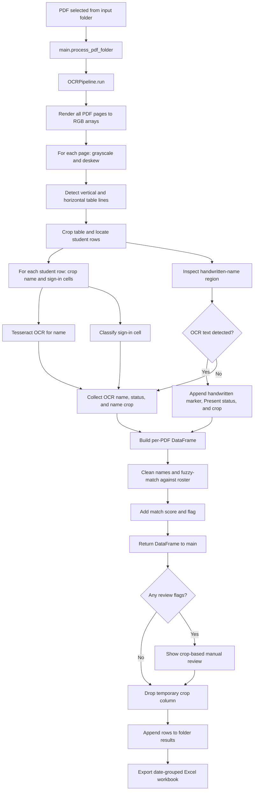

# OCR Data Flow

This document describes the OCR portion of the application as it is currently implemented. The pipeline returns a pandas DataFrame; the `AttendanceRecord` and `DailySheet` dataclasses in `ocr_pipeline/models.py` are not currently used to hold each processed student record.

## High-level flow

## Step-by-step details

### 1. Select and process PDFs

`main()` in `main.py` prompts for an input folder and loads the roster with `build_roster()`. It creates `PipelineConfig` and `OCRPipeline`, then calls `process_pdf_folder()`.

`process_pdf_folder()` finds `.pdf` files in the selected folder (case-insensitive extension) and sorts them by filename, case-insensitively. It processes one PDF at a time:

1. Call `pipeline.run(pdf_path)`.
2. Pass the returned DataFrame to `review_flagged_records()` through the review callback.
3. Remove the internal `_review_crop` column after review.
4. Add the cleaned DataFrame to the batch results.

After all files are processed, the per-PDF DataFrames are concatenated.

### 2. Render pages and prepare the table

`OCRPipeline.run()` calls `pdf_to_image()` in `ocr_pipeline/ingestion.py`. PyMuPDF renders each PDF page at the configured `DPI` (300 by default) into an RGB NumPy array. The current implementation renders all pages into a list before processing them.

For each page, the pipeline:

1. Converts the page to grayscale and estimates skew.
2. Deskews both grayscale and color page images when a non-zero skew is found.
3. Detects vertical lines, crops the configured table columns, and detects horizontal lines.
4. Handles the page header/date area when detected.
5. Uses `split_student_rows_and_handwritten_region()` to identify normal-height student rows and a potential handwritten-name region.

If the required table lines are not detected, the pipeline raises `TableDetectionError` rather than producing a normal attendance result for that page.

### 3. Extract each student's name and attendance

For every detected student row, the pipeline crops the name cell and sign-in region:

- **Name:** The RGB name crop is saved as a copy in the `review_crops` list. A separate crop has red strikethrough marks removed, is converted to grayscale, and is sent to `tesseract_ocr()`. The returned text is appended to `ocr_names`.
- **Attendance:** The sign-in area is passed to `classify_attendance()`, which returns `Present`, `Absent`, or `EMPTY CELL`. The result is appended to `attendance_statuses`.

The name, status, and crop lists are appended in the same order, so each row's crop is associated with its OCR name and attendance status.

### 4. Detect handwritten names

The pipeline crops the designated handwritten region from the name column and runs Tesseract through `detect_handwritten_names()`. If OCR returns any non-empty text, it appends:

- `WRITTEN NAME DETECTED` as the raw name,
- `Present` as the attendance status, and
- the handwritten-region crop as the review image.

This is a detection heuristic: non-empty OCR text in that region triggers manual review; it does not itself identify the student.

### 5. Build records and reconcile names

After processing the page images in the PDF, `OCRPipeline.run()` builds a DataFrame from:

- `ocr_raw`: extracted OCR name or handwritten marker,
- `attendance`: classified status,
- `_review_crop`: RGB NumPy image crop used by the review UI.

`fuzzy_match_names()` in `ocr_pipeline/reconciliation.py` cleans each OCR string and compares usable names with the roster using RapidFuzz's token-sort ratio. It adds:

- `cleaned_name`,
- `matched_name`,
- `matched_score`, and
- `flag`.

Typical flags include:

| Flag | Meaning / review behavior |
| --- | --- |
| `Strong Match` | Match score meets the configured threshold; no manual review |
| `Low Match - Needs Review` | A candidate exists but its score is below the strong-match threshold |
| `NoMatchFoundError` | No roster candidate or score below the configured floor |
| `OCRExtractionError` | No usable OCR name was extracted |
| `NEED-MANUAL-ENTRY` | Handwritten-name marker was added |
| `EMPTY CELL` | Name OCR was blank and the attendance cell was classified as empty; not sent to manual review |

The pipeline adds the detected sheet date as the `Date` column and returns this per-PDF DataFrame to `main.py`.

### 6. Review flagged records

`review_flagged_records()` in `ocr_pipeline/manual_review.py` filters rows whose `flag` is one of the review statuses. If none need attention, it returns immediately without opening a window.

Otherwise it creates a visible Tkinter root and calls `_show_review_queue()`. The single review window advances through flagged records and displays each crop, OCR text, match score, flag, and a roster dropdown:

- **Use selected name:** updates `matched_name` and changes the flag to `Resolved - Manual Review`.
- **Skip:** advances without changing the existing match or flag.
- **Close the window:** ends the review session; records not confirmed remain unresolved.

The image array is retained only long enough to support the in-memory review flow.

### 7. Remove review-only data and export

When the review callback returns to `process_pdf_folder()`, that function drops `_review_crop` before appending the DataFrame to the folder-wide results. `main()` then calls `export_attendance()` in `io_utils/excel_output.py`.

The Excel writer selects the public attendance columns, groups rows by date, creates one worksheet per date, and applies worksheet formatting. The image crops are not serialized into the workbook.

## Data and memory notes

- A name crop is a three-channel RGB NumPy array. The current pipeline copies and retains a crop for every extracted student row until that PDF finishes manual review, even when the row's flag does not require review.
- Crop pixel storage is approximately the sum of `crop.nbytes` across the `_review_crop` values. Pandas `DataFrame.memory_usage()` reports object references for this column, not the full pixel buffers.
- `pdf_to_image()` also creates and retains the rendered image array for every page in the PDF while `OCRPipeline.run()` processes the list. These full-page arrays contribute to peak memory independently of the crop arrays.
- Crops are removed after each PDF's review, before the per-PDF DataFrame is accumulated with results from other PDFs.
